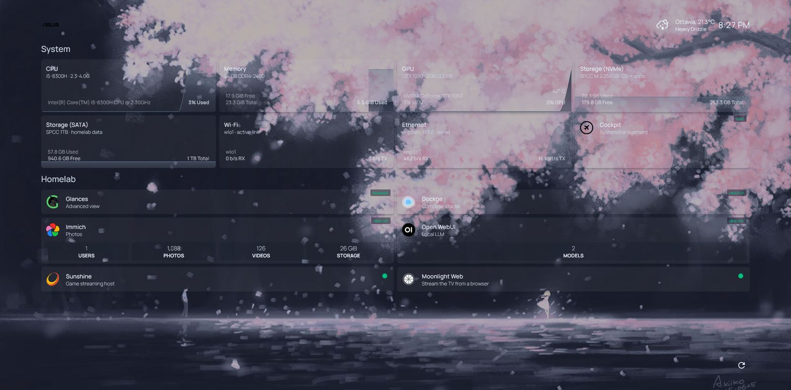
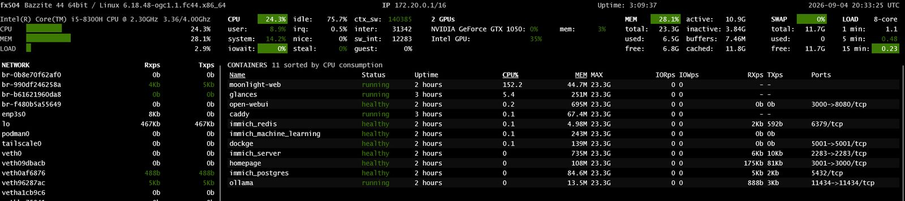
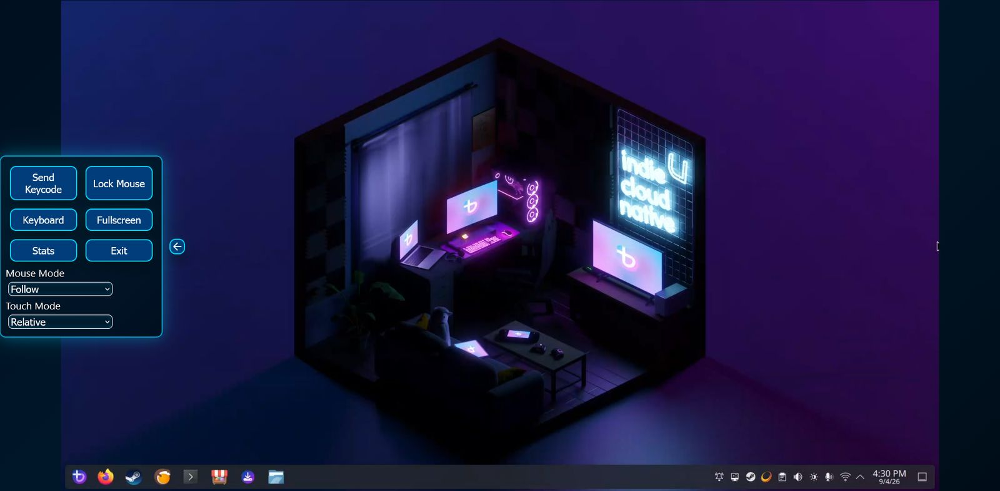
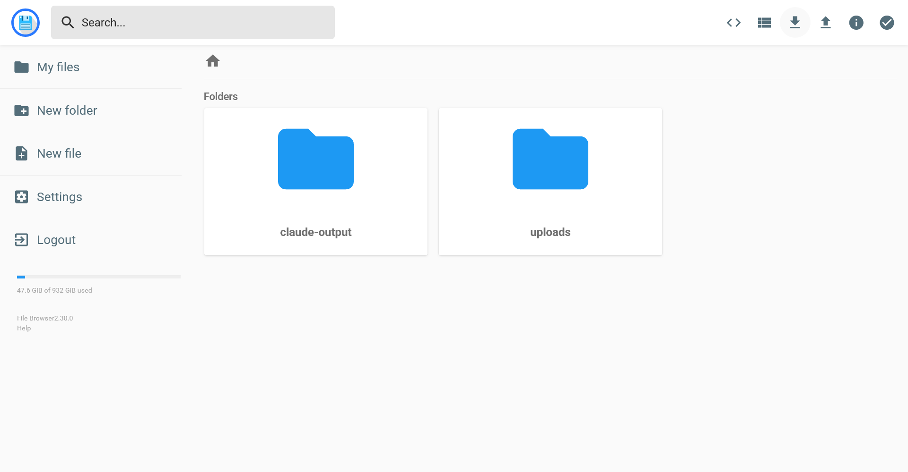
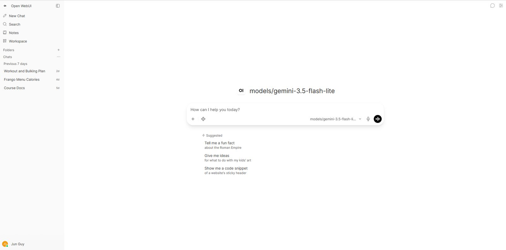

# Homelab

Self-hosted services on a single repurposed laptop (Asus TUF FX504, i5-8300H, 24 GB RAM, GTX 1050)
running [Bazzite](https://bazzite.gg/) — an immutable Fedora-based KDE gaming desktop.
**12 containers across 9 Docker Compose stacks**, every service behind HTTPS on a wildcard Let's Encrypt
certificate, reachable from anywhere over Tailscale with nothing exposed to the public internet.

## Dashboard



## Services

### Homepage


Service dashboard with live status cards for every stack — health, uptime, resource usage.

### Glances Monitoring


Host-level metrics: CPU, RAM, disk, GPU, temperatures, network throughput.

### Immich Photos


Self-hosted photo library replacing Google Photos. Auto-backup, face recognition, ML-powered search.

### Moonlight Streaming


Browser-based game and desktop streaming via NVIDIA Sunshine — play PC games on any device, anywhere.

### FileBrowser


Web-based file manager for uploads, edits, and serving project assets.

### FreeLLMAPI


Free-tier LLM router/gateway — 87 models across 11 providers (Groq, Cloudflare, NVIDIA, Google, Zhipu),
OpenAI-compatible API with context handoff between model switches. Used as backend for Hermes WebUI
and Claude Code.

### Hermes WebUI *(new)*
Latest addition: a web chat interface with built-in LaTeX rendering, persistent memory, and scheduled
tasks — connected to the FreeLLMAPI gateway for math/physics/signals problem solving.

## Design in one paragraph

DNS for the whole domain points at a **private** LAN address, so hostnames only resolve on the LAN or
over the tailnet. Caddy terminates TLS for every service using a wildcard certificate obtained through
the DNS-01 challenge (no inbound port 80/443 from the internet is ever needed). Tailscale advertises a
`/32` subnet route for just this host, so the same hostnames and the same certificate work identically
at home and away. There is no port forwarding and no public exposure. Details in
[docs/ARCHITECTURE.md](docs/ARCHITECTURE.md).

## Hardware

| Component | Spec |
|---|---|
| Machine | Asus TUF FX504GD |
| CPU | Intel Core i5-8300H (4c/8t) |
| RAM | 24 GB DDR4 |
| GPU | NVIDIA GTX 1050 2GB |
| Storage | 236 GB NVMe (OS) + 1 TB SATA (data) |
| OS | Bazzite (immutable Fedora Linux + KDE) |
| Network | WiFi + wired (1 Gbps) |
| Access | Tailscale (`100.126.33.49`) + LAN (`192.168.4.38`) |

## Stacks

| Stack | Container(s) | Port | Purpose |
|---|---|---|---|
| `caddy` | 1 | host:443 | Reverse proxy, wildcard TLS via DuckDNS |
| `dockge` | 1 | `:5001` | Compose stack management UI |
| `freellmapi` | 1 | `:8082` | LLM router / OpenAI-compatible gateway |
| `glances` | 1 | `:61208` | Host metrics monitoring |
| `homepage` | 1 | `:3001` | Service dashboard |
| `immich` | 4 | `:2283` | Photo library + ML + Postgres + Redis |
| `filebrowser` | 1 | `:8085` | Web file manager |
| `moonlight-web` | 1 | `:8080` | Browser game/desktop streaming |
| `hermes-webui` | 1 | `:8787` | LLM chat with LaTeX (pending deploy) |

## Deployment

```bash
# Start all stacks
cd /var/mnt/storage/docker/stacks
for d in *; do [ -d "$d" ] && cd "$d" && docker compose up -d && cd ..; done

# Rebuild/restart after code changes
cd ~/homelab/stacks/freellmapi && docker compose up -d --build

# Check status
docker ps --format 'table {{.Names}}\t{{.Status}}\t{{.Ports}}'
```

All stacks are tracked in this repo. New stacks get their own directory under `stacks/` with
`compose.yaml` and `.env.example`.

## Projects built from this homelab

- **[junguyen.me](https://junguyen.me)** — portfolio site hosted on GitHub Pages
- **MacTrack** — offline-first calorie/macro tracker (Kotlin/Jetpack Compose)
- **CEG 3155 Lab tools** — fixed-point ALU design, VHDL simulation, Notion integration
- **Hermes WebUI + LLM chat** — math/physics/signals study tool (in progress)

## Docs

| File | What it is |
|---|---|
| [docs/ARCHITECTURE.md](docs/ARCHITECTURE.md) | Network, proxy, DNS, and remote-access design |
| [docs/INCIDENTS.md](docs/INCIDENTS.md) | Append-only incident log: symptom → cause → fix → rule |
| [docs/RECOVERY.md](docs/RECOVERY.md) | Disaster-recovery runbook (tested) |
| [docs/DECISIONS.md](docs/DECISIONS.md) | Why things are the way they are |

## Highlights from the incident log

- **Local LLM inference ran on the CPU for six weeks.** Proved the container couldn't see the GPU,
  added the NVIDIA container runtime — roughly 10× throughput.
- **A streaming service exited cleanly after every reboot but never bound its port.** Replaced
  process-state checks with a systemd timer that health-checks the listening socket.
- **A pre-built reverse-proxy image couldn't bind port 443.** Rebuilt Caddy from source with
  `xcaddy` to get the DNS-01 plugin working on a non-root container.

## Secrets

No secret is committed. Every `.env` has a matching `.env.example` with the variable names and
nothing else. The credential manager is the source of truth; `.env` files on the host are
runtime copies. See `.gitignore`.

## Layout

```
stacks/<name>/compose.yaml   one directory per Compose stack
stacks/<name>/.env.example   variable names only
systemd/                     host-level units (battery cap, health-check timers)
docs/                        architecture, incidents, recovery, decisions
docs/img/                    screenshots and diagrams
```
